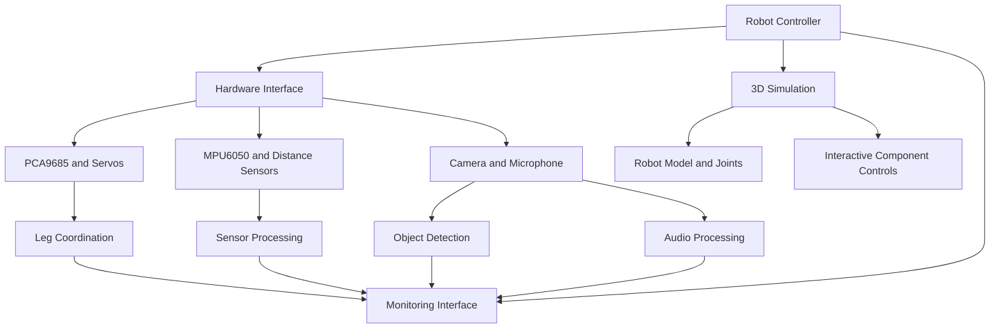

# KUKUR — Intelligent Quadruped Robot

**A Raspberry Pi 4-based quadruped robot with hardware control, interactive 3D simulation, computer vision, sensor integration, and planned autonomous locomotion.**

KUKUR is a modular robotics project designed to develop and test a quadruped robot in both a physical environment and a virtual simulation. The goal is to combine servo-based leg movement, sensor feedback, camera-based object detection, audio interaction, and a visual monitoring interface.

> **Project status:** Active development. Hardware commissioning, PCA9685 troubleshooting, and simulation development are in progress. Features described as planned are not yet verified as operational.

## Contents

- [Project Overview](#project-overview)
- [Core Features](#core-features)
- [System Architecture](#system-architecture)
- [Hardware Components](#hardware-components)
- [Servo Channel Mapping](#servo-channel-mapping)
- [Simulation Environment](#simulation-environment)
- [Computer Vision and Object Detection](#computer-vision-and-object-detection)
- [Audio and Display](#audio-and-display)
- [Sensors and Balance Control](#sensors-and-balance-control)
- [Software Structure](#software-structure)
- [Installation](#installation)
- [Running the Software](#running-the-software)
- [Development Roadmap](#development-roadmap)
- [Safety and Limitations](#safety-and-limitations)
- [Contributing](#contributing)

## Project Overview

KUKUR is intended to provide a complete development platform for a quadruped robot, including:

1. **Physical robot control** — operate the leg servos through a PCA9685 controller.
2. **Interactive simulation** — visualize the robot in 3D and move individual components to inspect their motion.
3. **Computer vision** — connect a camera module and display object-detection results.
4. **Audio interaction** — integrate a microphone for audio input and future voice commands.
5. **Sensor monitoring** — read IMU and distance-sensor data.
6. **Locomotion research** — develop coordinated leg movement, standing poses, and balance control.
7. **Monitoring interface** — show robot status, sensor readings, camera output, and simulation state.

The simulation and hardware-control systems should be developed as separate modules, sharing common configuration and robot-state definitions where practical.

## Core Features

| Feature | Purpose | Status |
|---|---|---|
| Raspberry Pi servo controller | Control 12 leg-servo channels | In development |
| Safety validation | Restrict servo command angles and validate channels | Software checks passed |
| Individual servo testing | Test one servo at a time | Hardware verification pending |
| Coordinated leg testing | Test three joints of one leg together | Pending hardware validation |
| Interactive 3D simulation | Visualize and manipulate robot components | Under development |
| Camera module | Capture live video | Integration pending |
| Object detection | Identify people and other objects in camera frames | Integration pending |
| Microphone | Capture audio input | Integration pending |
| Display interface | Show status and sensor information | Integration pending |
| MPU6050 IMU | Measure acceleration and angular velocity | Hardware validation pending |
| Distance sensors | Detect nearby obstacles | Depends on installed hardware |
| Standing and balance | Coordinate legs and correct body tilt | Planned |
| Walking gait | Generate coordinated quadruped locomotion | Disabled pending validation |

## System Architecture

The intended architecture separates the main functions into independent modules.



The diagram describes the intended design, not a claim that every connection is implemented.

## Hardware Components

| Component | Role |
|---|---|
| Raspberry Pi 4 | Main computing platform |
| PCA9685, expected address `0x40` | 16-channel PWM controller |
| MG995 servos | Joint actuation |
| Deao 20 kg servos | Joint actuation |
| MPU6050, expected address `0x68` | Accelerometer and gyroscope |
| I²C LCD, expected address `0x27` | Status display |
| HC-SR04 sensors, if installed | Distance measurement |
| Raspberry Pi camera module, if installed | Video capture |
| Microphone module, if installed | Audio input |
| External servo power supply | Supplies the servos independently of the Pi's logic power |

Verify actual device addresses, wiring, voltage requirements, and installed modules on the physical robot.

## Servo Channel Mapping

The current software mapping assigns three servo channels to each leg.

| Leg | Abduction | Hip pitch | Knee |
|---|---:|---:|---:|
| Front-left (FL) | CH0 | CH1 | CH2 |
| Front-right (FR) | CH3 | CH4 | CH5 |
| Back-left (BL) | CH6 | CH7 | CH8 |
| Back-right (BR) | CH9 | CH10 | CH11 |

Confirm each physical connection before enabling servo movement.

## Simulation Environment

The planned 3D simulation should allow developers to inspect the robot before moving the physical hardware.

### Intended capabilities

- Display a complete quadruped robot with a body, four legs, joints, and feet.
- Make individual joints and components selectable and movable.
- Provide controls for abduction, hip pitch, and knee movement.
- Visualize joint angles and current simulated pose.
- Test one leg at a time and later coordinate all four legs.
- Display a ground plane, obstacles, and the robot's surroundings.
- Integrate a virtual camera and show object-detection results.
- Display sensor readings and simulation status.
- Provide a reset-pose control and enforce configured joint limits.
- Separate simulated commands from physical hardware commands.

### Simulation and hardware separation

Simulation mode must not initialize or command physical servos by default. Hardware mode must require explicit activation and safety checks.

The simulation should not be described as a physics-accurate model until joint constraints, collision handling, mass properties, and motion behavior have been implemented and validated.

## Computer Vision and Object Detection

The intended camera pipeline is:

1. Capture frames from the camera module.
2. Pass frames to the selected object-detection model.
3. Identify detected objects and confidence scores.
4. Draw bounding boxes and labels over the video.
5. Display the annotated stream in the monitoring interface.
6. Make detection results available to higher-level robot logic.

Potential targets include people, common objects, and obstacles, depending on the model and dataset.

Detection does not automatically imply reliable obstacle avoidance. Navigation decisions require additional validation and appropriate safety logic.

## Audio and Display

### Microphone

Planned functions include:

- Capture microphone input.
- Monitor audio-device status.
- Support speech recognition if a suitable model is installed.
- Provide a foundation for future voice commands.

### LCD and monitoring interface

The LCD and software interface are intended to report:

- Hardware connection status
- IMU and distance readings
- Current robot mode
- Servo-test progress
- Camera and detection status
- Errors and safety faults

The LCD should not be treated as a substitute for an accessible physical emergency stop or power cutoff.

## Sensors and Balance Control

The MPU6050 provides accelerometer and gyroscope measurements. A calibrated processing pipeline is required before these measurements can be used for balance control.

The intended development sequence is:

1. Validate raw sensor readings.
2. Calibrate offsets and sensor orientation.
3. Estimate body orientation using an appropriate filtering method.
4. Establish safe standing poses.
5. Develop bounded corrective joint commands.
6. Test stability with the robot securely supported.
7. Evaluate standing behavior before considering walking.

If distance sensors are installed, they can provide obstacle-distance estimates. Sensor readings must be validated and checked for stale or implausible values.

## Software Structure

The repository should contain the actual source files for the implemented features. A possible organization is:

```text
KUKUR-Quadruped-Robot/
├── README.md
├── requirements.txt
├── .gitignore
├── main.py
├── config.py
├── safety.py
├── servo_driver.py
├── leg_test.py
├── lcd_display.py
├── imu_monitor.py
├── tests/
│   └── test_safety.py
├── simulation/
│   ├── robot_model/
│   ├── controllers/
│   └── assets/
├── vision/
│   ├── camera.py
│   └── object_detection.py
├── audio/
│   └── microphone.py
├── interface/
│   └── dashboard.py
└── docs/
    ├── wiring.md
    └── setup.md
```

This is a proposed layout. Keep only files and directories that exist or have been intentionally created; update the README as the project evolves.

## Installation

### Requirements

- Raspberry Pi OS for physical hardware operation
- Python version supported by the project's dependencies
- Git
- I²C enabled for the connected hardware
- Appropriate Python packages for the hardware and optional simulation modules

Clone the repository:

```bash
git clone https://github.com/pniraj310/KUKUR-Quadruped-Robot.git
cd KUKUR-Quadruped-Robot
```

Create a virtual environment appropriate for the current operating system.

On Raspberry Pi OS:

```bash
python3 -m venv .venv
source .venv/bin/activate
python -m pip install --upgrade pip
```

Install the dependencies declared by the project:

```bash
python -m pip install -r requirements.txt
```

Do not copy a Windows or Raspberry Pi virtual environment between platforms. Install dependencies separately for each environment.

Simulation dependencies may differ from the Raspberry Pi hardware dependencies. Document them separately if needed.

## Running the Software

The following commands apply to the existing hardware-control CLI, provided the corresponding source files and dependencies are present.

### Software-only checks

```bash
python -m py_compile main.py config.py safety.py servo_driver.py leg_test.py lcd_display.py imu_monitor.py
python -m unittest discover -s tests -v
python main.py --test-limits
python main.py --diag
```

These checks do not prove that the physical hardware is functioning.

### Hardware testing

Physical hardware tests must remain disabled until PCA9685 communication, servo power, grounding, starting position, and mechanical clearance have been verified.

The current intended single-servo command is:

```bash
python main.py --hardware --servo-test 7 --confirm-start-angle 95
```

**Do not execute this command while PCA9685 initialization remains faulty.** The `95` argument is a user confirmation, not position feedback from the servo.

Simulation commands should be documented here once the actual simulation framework and entry point are implemented.

## Current Hardware Debugging Status

PCA9685 initialization has encountered the following exception:

```text
ValueError: The device pre_scale register (0xFE)
was not read or returned a value < 3
```

Direct reads at I²C address `0x40` returned `0x00` for registers `0x00` and `0xFE`, although standalone ServoKit initialization succeeded once. The I²C scan output has also appeared abnormal.

This issue must be resolved before physical servo movement testing resumes. Do not bypass driver checks or assume the controller is reliable based on a single successful initialization.

## Development Roadmap

### Phase 1 — Hardware commissioning

- Resolve PCA9685 communication and initialization.
- Verify individual servo channels.
- Test one leg at a time.
- Validate the LCD, MPU6050, camera, microphone, and installed distance sensors.

### Phase 2 — Interactive simulation

- Build the 3D robot model.
- Implement independently movable joints and components.
- Add joint limits and pose reset.
- Visualize sensor data and camera output.
- Implement simulation-only leg tests.

### Phase 3 — Perception and interface

- Integrate camera capture and object detection.
- Add microphone capture and optional speech recognition.
- Build a status dashboard and display integration.

### Phase 4 — Standing and stability

- Define safe standing poses.
- Coordinate all four legs.
- Calibrate the IMU.
- Develop bounded balance corrections.
- Validate stability before enabling locomotion.

### Phase 5 — Walking and autonomy

- Develop and validate a gait generator.
- Add obstacle-awareness and movement-state management.
- Test progressively under controlled conditions.
- Keep an immediate stop mechanism available throughout development.

## Safety and Limitations

- The configured servo command range is 90°–100°; these are software bounds, not guarantees of mechanical safety.
- The PCA9685 does not report actual shaft positions.
- The robot must be physically supported during initial movement tests.
- Use an appropriate external servo supply and a shared ground.
- Never power the servos directly from the Raspberry Pi's 5 V pin.
- Do not enable walking or automatic balance before the underlying hardware and standing behavior have been validated.
- Simulation results are not proof of real-world mechanical or control-system performance.

## Contributing

Contributions are welcome as the project develops. Changes should preserve the safety checks, keep simulation separate from physical hardware control, and include relevant software tests and updated documentation.

## License

No license has been selected yet. Add an appropriate open-source license before inviting others to reuse, modify, or distribute the project.

---

**Project:** KUKUR — Intelligent Quadruped Robot  
**Repository:** https://github.com/pniraj310/KUKUR-Quadruped-Robot  
**Platform:** Raspberry Pi 4  
**Primary language:** Python
1. Install dependencies:
   `npm install`
2. Set the `GEMINI_API_KEY` in [.env.local](.env.local) to your Gemini API key
3. Run the app:
   `npm run dev`
